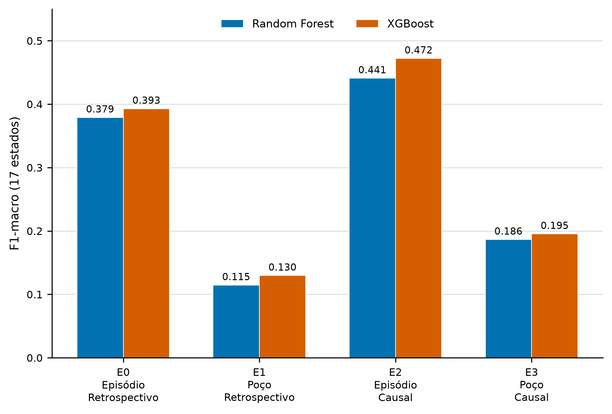

# Validação fisicamente independente no 3W Dataset

[](https://github.com/Santana-DS/pfc3w/actions/workflows/quality.yml)
[](https://github.com/Santana-DS/pfc3w/actions/workflows/pages.yml)

Estudo sobre generalização entre poços físicos, pré-processamento temporal
causal e explicabilidade de classificadores de estados operacionais no 3W
Dataset. Projeto desenvolvido por Lucas Santana da Silva no curso de Engenharia
Mecatrônica — Controle e Automação da Universidade de Brasília.

## Pergunta de pesquisa

Em que medida o desempenho e as explicações de classificadores se mantêm
quando:

1. poços físicos são separados integralmente entre treino e teste; e
2. o pré-processamento usa somente informação disponível até o instante da
   previsão?

O trabalho de Gabriel Rabelo fornece o baseline metodológico. Este projeto
contribui com a auditoria da unidade de validação, uma matriz fatorial que isola
dependência física e regime temporal, proveniência de artefatos e uma prova de
conceito XAI sob independência por poço.



## Resultado central

As quatro células E0--E3 usam a mesma população real: 159.779 janelas, 960
episódios aceitos, 35 poços, oito sensores e 88 atributos.

| Contraste | Fator alterado | Random Forest | XGBoost |
|---|---|---:|---:|
| E1 − E0 | episódio → poço, retrospectivo | −0,2645 | −0,2632 |
| E3 − E2 | episódio → poço, causal | −0,2544 | −0,2768 |
| E2 − E0 | retrospectivo → causal, episódio | +0,0618 | +0,0793 |
| E3 − E1 | retrospectivo → causal, poço | +0,0719 | +0,0657 |

A separação por poço produz a maior mudança de desempenho. O pré-processamento
causal melhora ambos os modelos avaliados, mas não elimina a dificuldade de
transferência para sistemas físicos não vistos.

## Desenho experimental

| Código | População | Unidade do fold | Pré-processamento | Papel |
|---|---|---|---|---|
| R0 | todas as origens | identidade legada | histórico publicado | reprodução do baseline |
| E0 | real | episódio | retrospectivo | controle mais permissivo |
| E1 | real | poço | retrospectivo | independência física |
| E2 | real | episódio | causal | efeito temporal |
| E3 | real | poço | causal | cenário principal |

O protocolo completo está em [docs/protocol.md](docs/protocol.md). A síntese dos
resultados está em [docs/e0_e3_preliminary.md](docs/e0_e3_preliminary.md), e a
prova de conceito SHAP em [docs/xai_pilot.md](docs/xai_pilot.md).

## Reprodução leve

Requisitos: Python 3.11 ou 3.12.

```powershell
python -m venv .venv
.venv\Scripts\python.exe -m pip install -e .
.venv\Scripts\python.exe -m ruff check .
.venv\Scripts\python.exe -m pytest -q
```

Os dados brutos, modelos, previsões completas e tabelas intermediárias não são
armazenados neste repositório. Figuras, tabelas resumidas, configurações e
hashes necessários à auditoria dos resultados publicados são versionados.

## Proveniência

- [reports/artifact_manifest.csv](reports/artifact_manifest.csv) relaciona cada
  tabela ou figura às entradas e ao código gerador;
- [config/reporting/public/results.yaml](config/reporting/public/results.yaml)
  reúne os identificadores científicos publicados;
- [docs/artifact_provenance.md](docs/artifact_provenance.md) descreve os gates de
  promoção dos artefatos;
- os JSONs em `reports/tables` e `reports/figures` registram hashes das entradas
  e saídas.

## Site documental

O [companion site](https://santana-ds.github.io/pfc3w/) apresenta problema,
método, resultados, XAI, limitações e reprodução em uma narrativa dirigida ao
leitor. As fontes estão em [site/](site/), e a renderização e a implantação são
verificadas automaticamente pelos workflows do repositório.

## Dados, atribuição e citação

O projeto utiliza o 3W Dataset 2.0.0. Licenças, transformações e atribuições
estão registradas em [NOTICE](NOTICE). Os metadados para citação desta versão
estão em [CITATION.cff](CITATION.cff), e a bibliografia científica em
[references/library.bib](references/library.bib).

O código original deste repositório é distribuído sob a
[Apache License 2.0](LICENSE). O dataset e materiais de terceiros permanecem
sujeitos às licenças e atribuições indicadas em `NOTICE`.

## Limitações

Os resultados não constituem certificação operacional. Classes raras possuem
cobertura física desigual, os hiperparâmetros não foram ajustados em validação
aninhada por poço e a prova XAI atual cobre um único fold de E3. A discussão
completa está em [site/limitations.qmd](site/limitations.qmd).
